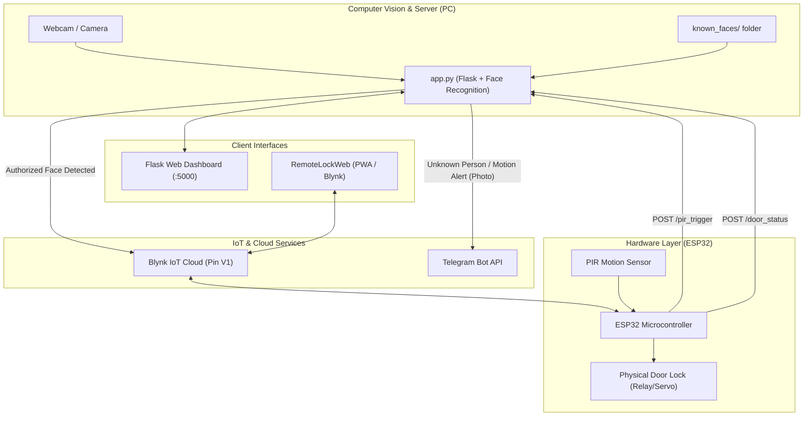

# 🔐 Smart Door Lock System with Face Recognition & IoT Control

An intelligent, IoT-enabled Smart Door Lock System featuring real-time AI face recognition, automatic door unlocking, intruder alerts via Telegram, ESP32 hardware integration, and a mobile-friendly remote web dashboard.

---

## 🌟 Key Features

- **👤 AI Face Recognition**: Automatically recognizes authorized individuals using OpenCV and `face_recognition` (dlib) via a connected camera or webcam.
- **🔓 Automatic Door Unlock & Auto-Relock**: Unlocks the door instantly when a recognized person is detected, keeps it open for a configurable duration (default: 5 seconds), and automatically re-locks.
- **🚨 Telegram Intruder Alerts**: Automatically captures and dispatches a photo alert to your Telegram bot whenever an unknown visitor or motion is detected while the door is locked.
- **🌐 Dual Web Dashboards**:
  - **Live Monitoring Dashboard** (`http://localhost:5000`): Live video feed, real-time lock status, authorized faces list, and manual unlock button.
  - **Remote Lock Web App** (`RemoteLockWeb/index.html`): Mobile-friendly, glassmorphic Progressive Web App (PWA) that controls the door lock remotely via the Blynk IoT Cloud API.
- **⚡ ESP32 Hardware Integration**:
  - Controls the physical door lock mechanism (solenoid/servo/relay).
  - Integrates PIR motion sensors to notify the PC camera when movement is detected.
  - Bidirectional status synchronization between PC and ESP32 via REST API and Blynk Virtual Pin `V1`.

---

## 🏗️ System Architecture



---

## 📁 Project Structure

```text
SmartDoorLockSystem/
│
├── .github/
│   └── workflows/
│       └── deploy.yml         # GitHub Actions workflow for automated Pages deployment
│
├── known_faces/               # Store authorized person photos (e.g., tushar.jpg)
│
├── templates/
│   └── index.html             # Flask live streaming web dashboard
│
├── RemoteLockWeb/             # Standalone Remote Control Web App
│   ├── index.html             # Responsive glassmorphism interface (Blynk Cloud API)
│   └── manifest.json          # PWA manifest for mobile home screen installation
│
├── app.py                     # Main Python application (Flask, Face Rec, Telegram, Blynk)
├── esp32_code_snippets.txt    # ESP32 C++ code snippets for WiFi, Blynk, and PC integration
├── vercel.json                # Vercel deployment configuration
├── netlify.toml               # Netlify deployment configuration
├── .gitignore                 # Git ignore rules
└── README.md                  # Project documentation
```

---

## 🛠️ Prerequisites & Installation

### 1. Python Environment Setup

Ensure you have **Python 3.8 to 3.11** installed.

> [!NOTE]
> Installing `face_recognition` requires CMake and C++ Build Tools on Windows:
> - Install [CMake](https://cmake.org/download/)
> - Install Visual Studio Community with the **"Desktop development with C++"** workload.

Install the required Python dependencies:
```bash
pip install flask opencv-python face-recognition numpy requests
```

### 2. Configure Authorized Faces

Place photos of authorized individuals into the `known_faces/` folder:
- Supported formats: `.jpg`, `.jpeg`, `.png` (e.g., `tushar.jpg`).
- The filename without the extension automatically becomes the person's display name.

---

## ⚙️ Configuration

Open [`app.py`](file:///d:/Doorlockweb/app.py) and update the configuration section at the top:

```python
# ===== CONFIGURATION & CREDENTIALS =====
TELEGRAM_TOKEN    = "YOUR_TELEGRAM_BOT_TOKEN"
CHAT_ID           = "YOUR_TELEGRAM_CHAT_ID"
KNOWN_FACES_DIR   = "known_faces"

BLYNK_AUTH_TOKEN  = "YOUR_BLYNK_AUTH_TOKEN"
BLYNK_PIN         = "V1"     # Virtual Pin: 0 = Unlocked, 1 = Locked
AUTO_RELOCK_DELAY = 5        # Auto re-lock duration in seconds
UNLOCK_COOLDOWN   = 15       # Minimum seconds between auto-unlock triggers
COOLDOWN          = 15       # Unknown visitor alert cooldown in seconds
# =======================================
```

---

## 🚀 Running the System

### 1. Start the Flask Server
Run the application from the project root:
```bash
python app.py
```
The server will bind to `http://0.0.0.0:5000`.

### 2. Access the Dashboards
- **Local Monitoring Dashboard**: Open `http://localhost:5000` (or `http://<YOUR_PC_IP>:5000` on your local network).
  - Watch real-time video feed with facial bounding boxes and recognition labels.
  - View live lock status (`Locked`, `Unlocking...`, `Unlocked`).
  - Click **"🔓 Unlock Door"** to manually open the lock.
- **Remote Lock Web App**:
  - Locally: Navigate to `http://localhost:5000/remote` or open [`RemoteLockWeb/index.html`](file:///d:/Doorlockweb/RemoteLockWeb/index.html).
  - Online: Access via GitHub Pages, Vercel, or Netlify from any mobile browser.

---

## 📡 REST API Reference

The Flask application exposes the following endpoints:

| Endpoint | Method | Description |
|---|---|---|
| `/` | `GET` | Serves the main live video streaming and monitoring dashboard |
| `/remote` | `GET` | Serves the standalone Remote Lock Web App |
| `/video_feed` | `GET` | Streams the real-time MJPEG video feed |
| `/get_status` | `GET` | Returns JSON containing current door lock status, unlocking flag, and authorized faces |
| `/unlock_door` | `POST` | Triggers a manual door unlock with automatic re-locking |
| `/door_status` | `POST` | Endpoint for ESP32 to report door status updates (`{"locked": true/false}`) |
| `/pir_trigger` | `POST` | Endpoint for ESP32 to trigger motion detection alerts when door is locked |

---

## 🌐 Deploying the Remote Lock Website

The `RemoteLockWeb` dashboard is a standalone, client-side web application that connects directly to the Blynk Cloud API. You can deploy it for free:

### Option 1: GitHub Pages (Automated via Actions)
A GitHub Actions workflow is included at `.github/workflows/deploy.yml`:
1. In your GitHub repository, navigate to **Settings** > **Pages**.
2. Under **Build and deployment** > **Source**, select **GitHub Actions**.
3. Push changes to the `main` branch.
4. Your website will automatically go live at:
   `https://<your-username>.github.io/<repository-name>/`
5. Open this link on your smartphone and select **"Add to Home Screen"** to use it as a native app.

### Option 2: Vercel (1-Click Deployment)
1. Log in to [vercel.com](https://vercel.com) and import this repository.
2. The included [`vercel.json`](file:///d:/Doorlockweb/vercel.json) will automatically route traffic to `RemoteLockWeb`.
3. Click **Deploy**.

### Option 3: Netlify
1. Connect your repository to [netlify.com](https://netlify.com).
2. The included [`netlify.toml`](file:///d:/Doorlockweb/netlify.toml) will publish the `RemoteLockWeb` folder.
3. Click **Deploy**.

---

## 🔌 ESP32 Microcontroller Integration

Refer to [`esp32_code_snippets.txt`](file:///d:/Doorlockweb/esp32_code_snippets.txt) for sample integration code in the Arduino IDE:

1. **Required Libraries**:
   - `WiFi.h`
   - `BlynkSimpleEsp32.h`
   - `WiFiClientSecure.h`
   - `UniversalTelegramBot.h`

2. **Core Functions**:
   - `notifyPC_PIR()`: Sends `POST /pir_trigger` to the PC server when the PIR sensor detects motion.
   - `notifyPC_DoorStatus(bool locked)`: Sends `POST /door_status` to synchronize state with the PC.
   - `BLYNK_WRITE(V1)`: Handles lock and unlock signals received from the Blynk Cloud (`0` = Unlock, `1` = Lock).

---

## 🔒 Security Best Practices

- Store `TELEGRAM_TOKEN` and `BLYNK_AUTH_TOKEN` securely. In production environments, use environment variables (`.env`).
- Provide clear, high-resolution, front-facing reference images in `known_faces/` for accurate facial recognition.
- Keep `UNLOCK_COOLDOWN` enabled to prevent flooding the microcontroller with repeat commands.

---

## 📜 License

This project is licensed under the MIT License.
