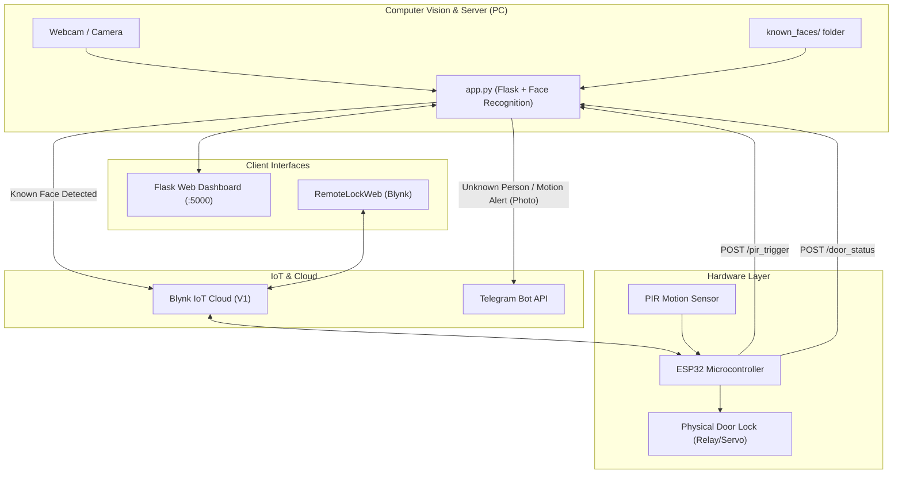

# 🔐 Smart Door Lock System with Face Recognition & IoT Control

An intelligent, IoT-enabled Smart Door Lock System featuring real-time AI face recognition, automatic door unlocking, unknown visitor intruder alerts via Telegram, ESP32 hardware integration, and a dual web control dashboard.

---

## 🌟 Key Features

- **👤 AI Face Recognition**: Automatically recognizes authorized individuals using OpenCV and `face_recognition` (dlib) via a connected camera/webcam.
- **🔓 Automatic Door Unlock & Auto-Relock**: Unlocks the door instantly when a known person is detected, keeps it open for a preset duration (default: 5 seconds), and automatically re-locks.
- **🚨 Telegram Intruder Alerts**: Automatically captures and sends a photo alert to your Telegram bot when an unknown person or motion is detected while the door is locked.
- **🌐 Dual Web Dashboards**:
  - **Live Monitoring Dashboard** (`http://localhost:5000`): Live video feed, real-time lock status, authorized faces list, and manual unlock button.
  - **Remote Lock Web App** (`RemoteLockWeb/index.html`): Mobile-friendly, sleek glassmorphic UI that controls the door lock remotely via the Blynk IoT Cloud API.
- **⚡ ESP32 Hardware Integration**:
  - Controls the physical door lock mechanism (relay/servo).
  - Integrates PIR motion sensors to trigger PC camera alerts when movement is detected.
  - Bidirectional status updates between PC and ESP32 via REST API and Blynk Virtual Pin `V1`.

---

## 🏗️ System Architecture



---

## 📁 Project Structure

```text
SmartDoorLockSystem/
│
├── known_faces/               # Store authorized person photos (e.g., tushar.jpg)
├── templates/
│   └── index.html             # Flask live streaming web dashboard
├── RemoteLockWeb/
│   └── index.html             # Standalone Blynk remote control web application
├── app.py                     # Main Python application (Flask, Face Rec, Telegram, Blynk)
├── esp32_code_snippets.txt    # ESP32 C++ snippets for WiFi, Blynk, and PC communication
├── .gitignore
└── README.md                  # Project documentation
```

---

## 🛠️ Prerequisites & Installation

### 1. Python Environment Setup

Ensure you have **Python 3.8 - 3.11** installed.

> [!NOTE]
> Installing `face_recognition` requires CMake and C++ Build Tools on Windows:
> - Install [CMake](https://cmake.org/download/)
> - Install Visual Studio Community with "Desktop development with C++"

Install required Python dependencies:
```bash
pip install flask opencv-python face-recognition numpy requests
```

### 2. Configure Authorized Faces

Add photos of authorized persons into the `known_faces/` folder:
- Name format: `<name>.jpg` or `<name>.png` (e.g., `tushar.jpg`)
- The file name without extension will automatically be used as the person's display name.

---

## ⚙️ Configuration

Open [`app.py`](file:///d:/Doorlockweb/app.py) and update the configuration section at the top:

```python
# ===== CONFIGURATION =====
TELEGRAM_TOKEN    = "YOUR_TELEGRAM_BOT_TOKEN"
CHAT_ID           = "YOUR_TELEGRAM_CHAT_ID"
KNOWN_FACES_DIR   = "known_faces"

BLYNK_AUTH_TOKEN  = "YOUR_BLYNK_AUTH_TOKEN"
BLYNK_PIN         = "V1"     # Virtual Pin: 0 = Unlocked, 1 = Locked
AUTO_RELOCK_DELAY = 5        # Auto re-lock duration (seconds)
UNLOCK_COOLDOWN   = 15       # Cooldown between auto-unlock triggers (seconds)
COOLDOWN          = 15       # Unknown visitor alert cooldown (seconds)
# =========================
```

---

## 🚀 Running the System

### 1. Start the Python Server
Run the Flask server from the project root:
```bash
python app.py
```
The server will start on `http://0.0.0.0:5000`.

### 2. Access the Dashboards
- **Local Monitoring Dashboard**: Open `http://localhost:5000` (or `http://<YOUR_PC_IP>:5000` on your local network).
  - View real-time webcam feed with face bounding boxes and names.
  - Check live door lock state.
  - Click **"🔓 Unlock Door"** to manually trigger an unlock.
- **Remote Web Access**: Open [`RemoteLockWeb/index.html`](file:///d:/Doorlockweb/RemoteLockWeb/index.html) in any browser to toggle the lock directly over Blynk cloud.

---

## 🔌 ESP32 Microcontroller Setup

Refer to [`esp32_code_snippets.txt`](file:///d:/Doorlockweb/esp32_code_snippets.txt) for sample integration code in Arduino IDE:

1. **Libraries Required**:
   - `WiFi.h`
   - `BlynkSimpleEsp32.h`
   - `WiFiClientSecure.h`
   - `UniversalTelegramBot.h`

2. **Key Functions**:
   - `notifyPC_PIR()`: Calls `POST /pir_trigger` on the PC server when PIR sensor detects motion.
   - `notifyPC_DoorStatus(bool locked)`: Sends `POST /door_status` to synchronize state with the PC.
   - `BLYNK_WRITE(V1)`: Listens for lock/unlock commands from the Blynk Cloud.

---

## 🔒 Security Best Practices

- Keep your `TELEGRAM_TOKEN` and `BLYNK_AUTH_TOKEN` private. Use environment variables (`.env`) for production deployments.
- Use clear, front-facing, well-lit photos in `known_faces/` for accurate facial recognition.
- Keep the `UNLOCK_COOLDOWN` enabled to prevent flooding the microcontroller with repeat signals.

---

## 📜 License

This project is licensed under the MIT License.
